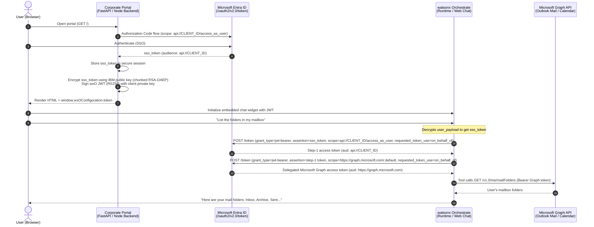

# OBO Flow: Microsoft Entra ID (Native Two-Step Exchange)

This document describes the recommended architecture and implementation for running the OAuth 2.0 On-Behalf-Of (OBO) flow (`oauth_auth_on_behalf_of_flow`) with **Microsoft Entra ID** and watsonx Orchestrate (wxO).

---

## Architecture

In watsonx Orchestrate, delegating user credentials to downstream tools via the embedded web chat uses a two-step OBO mechanism (`oauth_auth_on_behalf_of_flow`). Microsoft Entra ID implements it natively: the `jwt-bearer` grant type (`urn:ietf:params:oauth:grant-type:jwt-bearer`, from RFC 7523) combined with Microsoft's `requested_token_use=on_behalf_of` parameter.

### Why Entra ID Does Not Need a Second IdP

Microsoft Entra ID serves as both the **User Identity Provider** and the **Resource Authorization Server**:
1. When a user logs into your portal, Entra ID issues an `sso_token` scoped to the portal application itself (`api://{CLIENT_ID}/access_as_user`).
2. In **OBO Step 1**, wxO calls Entra ID's `/token` endpoint with the `sso_token`. Entra ID validates the user assertion and returns an intermediate token scoped to the portal API.
3. In **OBO Step 2**, wxO calls the **same** Entra ID `/token` endpoint with the Step 1 token, requesting the target resource scope (such as `https://graph.microsoft.com/.default`). Entra ID issues a delegated Microsoft Graph access token.

Because Entra ID natively supports both token exchange steps against its standard OAuth 2.0 v2.0 endpoint, no additional token broker or secondary IdP is needed.

---

## High-Level Sequence Diagram



---

## High-Level Implementation Steps

### 1. Microsoft Entra ID Configuration

1. **App Registration**:
   * Register an application (single tenant).
   * Configure Web Redirect URI: `https://<portal-domain>/auth/callback`.
   * Create a Client Secret (`CLIENT_SECRET`).
   * Record `CLIENT_ID` and `TENANT_ID`.

2. **Expose an API**:
   * Set Application ID URI: `api://{CLIENT_ID}`.
   * Add Scope: `access_as_user` (full scope: `api://{CLIENT_ID}/access_as_user`).
   * *Why this scope is required:* The initial `sso_token` must be issued for this API audience. A token issued directly for Microsoft Graph cannot be used as an OBO assertion (returns `AADSTS50013`).

3. **Microsoft Graph API Permissions**:
   * Add Delegated permissions (e.g. `User.Read`, `Mail.Read`, `Mail.ReadWrite`, `Mail.Send`).
   * Grant Admin Consent for the tenant.

---

### 2. Portal Backend Implementation

The hosting application (e.g. Python / FastAPI or Node.js) handles session management and JWT minting:

1. **Sign in user with Entra ID**:
   * Request scope: `api://{CLIENT_ID}/access_as_user`.
   * Store the returned `sso_token` in a secure, signed session cookie.

2. **Generate Client RSA Key Pair**:
   * Generate a private/public RSA key pair (e.g. 4096-bit).
   * Register the public key in watsonx Orchestrate under **Settings -> Embed Security**.

3. **Retrieve wxO Instance Public Key**:
   * Download the IBM instance public key (`wxo-ibm-public.pem`, RSA-2048) from **Settings -> Embed Security**.

4. **Encrypt `sso_token` and Sign the wxO JWT**:
   * Wrap `{"sso_token": "<token>"}` in chunked RSA-OAEP (SHA-1) using the IBM public key to produce `user_payload`.
   * Sign `{ sub, exp, user_payload, context }` using RS256 with the client private key.

5. **Serve the Web Chat**:
   * Embed `window.wxOConfiguration.token` with the signed JWT.
   * Handle the `authTokenNeeded` event to refresh tokens automatically.

---

### 3. watsonx Orchestrate Connection Configuration

Configure your custom connection with **Single Sign-On (SSO)** set to `On` and authentication type `OAuth2 On Behalf Of Flow` (Member credentials).

#### Step 1: Identity Provider Config (IdP Exchange)
* **IDP Url**: `https://login.microsoftonline.com/{TENANT_ID}/oauth2/v2.0/token`
* **Client ID**: `{CLIENT_ID}`
* **Client Secret**: `{CLIENT_SECRET}`
* **IDP Grant Type**: `urn:ietf:params:oauth:grant-type:jwt-bearer`
* **Scope**: `api://{CLIENT_ID}/access_as_user`
* **Request Token Use**: `on_behalf_of`
* **Request Token Type**: *(must be left empty)*

#### Step 2: Application Config (Resource Exchange)
* **Server URL**: `https://graph.microsoft.com`
* **Token URL**: `https://login.microsoftonline.com/{TENANT_ID}/oauth2/v2.0/token`
* **Application Client ID**: `{CLIENT_ID}`
* **Grant Type**: `urn:ietf:params:oauth:grant-type:jwt-bearer`
* **Token Request Fields (Body)**:
  * `requested_token_use`: `on_behalf_of`
  * `scope`: `https://graph.microsoft.com/.default`
  * `client_secret`: `{CLIENT_SECRET}`

#### ADK CLI Configuration (Recommended)

Replace `AppId` with the `app_id` of your own connection (for example `microsoft_ibm_184bdbd3` for the pre-built Microsoft connection). Read the client secret from your environment instead of typing it into the script. Note that the ADK receives it as a command-line argument, so run this only from a trusted workstation and never commit or paste the values.

```bash
AppId="microsoft_ibm_184bdbd3"
TenantId="<TENANT_ID>"
ClientId="<CLIENT_ID>"
Secret="${CLIENT_SECRET:?export CLIENT_SECRET first}"
TokenUrl="https://login.microsoftonline.com/$TenantId/oauth2/v2.0/token"
Jwt="urn:ietf:params:oauth:grant-type:jwt-bearer"

for env in draft live; do
  orchestrate connections configure -a $AppId --env $env \
    -t member -k oauth_auth_on_behalf_of_flow --sso \
    --server-url https://graph.microsoft.com \
    --idp-token-use on_behalf_of \
    --idp-token-type='' \
    --idp-token-header 'content-type: application/x-www-form-urlencoded' \
    --app-token-header 'content-type: application/x-www-form-urlencoded'

  orchestrate connections set-identity-provider -a $AppId --env $env \
    --url $TokenUrl --client-id $ClientId --client-secret $Secret \
    --scope "api://$ClientId/access_as_user" --grant-type $Jwt \
    -t 'body:requested_token_use=on_behalf_of'

  orchestrate connections set-credentials -a $AppId --env $env \
    --client-id $ClientId --token-url $TokenUrl --grant-type $Jwt \
    -t 'body:requested_token_use=on_behalf_of' \
    -t 'body:scope=https://graph.microsoft.com/.default' \
    -t "body:client_secret=$Secret"
done
```

---

## User Experience and Security Characteristics

* **Zero-Click Transparency**: The end user signs into the portal once. The embedded chat performs OBO exchanges silently in the background without prompting the user with a "Connect" button or redirect.
* **Least Privilege**: The `sso_token` stored in the user's session only has audience `api://{CLIENT_ID}`. It cannot directly read Microsoft Graph resources without the client secret and OBO exchange executed inside watsonx Orchestrate.
* **Token Confidentiality**: In the JWT sent to the browser, the `sso_token` is encrypted using watsonx Orchestrate's public key inside `user_payload`, preventing client-side inspection or tampering. (Server-side, it is stored in the signed session cookie.)