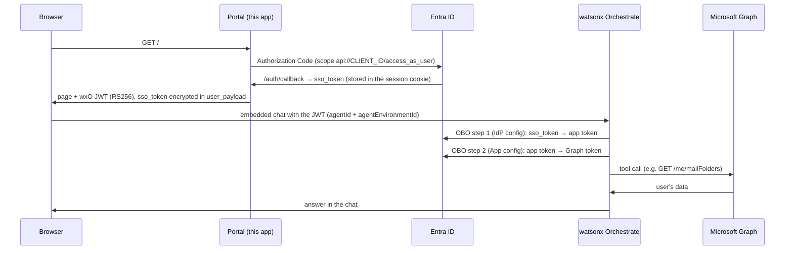

# OBO-entraID

FastAPI portal that embeds the **watsonx Orchestrate (wxO) chat** and passes it the user's **Microsoft Entra ID** identity, so that wxO tools can call **Microsoft Graph on behalf of the signed-in user** (OAuth2 On-Behalf-Of, OBO).

Validated with a copy of the wxO catalog agent **Email management** (Outlook version) and the pre-built connection `microsoft_ibm_184bdbd3`: the Outlook tools return the signed-in user's mail folders and latest emails.

## How it works



Key implementation points (see comments in `main.py`):

- **JWT** (`build_wxo_jwt`): RS256 signed with `wxo-client-private.pem`, claims `sub`, `exp` (max 7100 s), `user_payload`, `context` (email only).
- **`user_payload` chunking**: RSA-OAEP with a 2048-bit key encrypts at most 214 bytes, an Entra token is ~1,900 chars. The payload is split Node-RSA style into equal blocks, each encrypted with RSA-OAEP SHA-1 (MGF1-SHA1) using `wxo-ibm-public.pem`, concatenated and base64-encoded — the format wxO decrypts.

## Routes

| Route | Purpose |
|---|---|
| `/` | Portal: Entra sign-in, then page with the wxO embedded chat (bottom right). |
| `/chat-host` | Same, with the chat in a full-screen custom layout. |
| `/debug` | Replays from the server the two OBO exchanges wxO performs, then the Graph call `GET /me/mailFolders`. Shows the exact HTTP requests, a copyable `curl` (secrets as shell variables) and the results. |

Technical routes: `/auth/callback` (Entra callback), `/api/token` (JWT renewal used by the widget on `authTokenNeeded`), `/logout`.

## Prerequisites

1. **Entra ID App Registration**
   - Web redirect URI: `https://<your-app-url>/auth/callback` (and `http://localhost:8080/auth/callback` for local tests)
   - A client secret
   - *Expose an API*: scope `access_as_user` (Application ID URI `api://<CLIENT_ID>`)
   - Delegated Graph permissions (e.g. `User.Read`, `Mail.Read`) with **admin consent**
2. **watsonx Orchestrate**
   - Agent: **Build & Run → Catalog → Agents**, search *Email management* (two agents share this name: take the **Outlook** one, not Gmail) → **Use as template**, then deploy your copy to **Live**.
   - Embed security is set for the whole instance: profile icon (top right) → **Settings** → **Embed Security** tab. Set **Security** to **On**, paste `wxo-client-public.pem` (see step 3), generate the IBM key and save it as `wxo-ibm-public.pem` in the project root.
   - Values for `.env`: **Active inventory → Agents** → your copy → **Deploy** → **Live** tab → **Channels → Embedded agent**. Take the snippet from the **Live** tab so that `agentEnvironmentId` (`WXO_AGENT_ENV_ID`) is the Live environment, where the OBO connection is configured.
3. **Keys**: no key files are shipped in this repository (`*.pem` is gitignored). The app needs `wxo-client-private.pem` and `wxo-ibm-public.pem` in the project root before you run or build it:

   | File | Origin | Used for |
   |---|---|---|
   | `wxo-client-private.pem` | You generate it (below) | Signs the JWT (RS256) sent to wxO. Never share or commit it. |
   | `wxo-client-public.pem` | You generate it (below) | Pasted into wxO **Embed Security** so wxO can verify your JWT signature. Not read by the app. |
   | `wxo-ibm-public.pem` | Generated by wxO in **Embed Security** (see the wxO prerequisite above) | Encrypts the `sso_token` in `user_payload`. Specific to your wxO instance. |

   Generate your own client key pair:
   ```bash
   openssl genpkey -algorithm RSA -pkeyopt rsa_keygen_bits:4096 -out wxo-client-private.pem
   openssl rsa -in wxo-client-private.pem -pubout -out wxo-client-public.pem
   ```
   Then in wxO paste the content of `wxo-client-public.pem`, click to generate the IBM key, and save the displayed public key as `wxo-ibm-public.pem` (PEM format, starting with `-----BEGIN PUBLIC KEY-----`). The app exits at startup with a "Key file not found" message if either private/IBM file is missing.
4. **Tools** for deployment: `podman` or `docker`, and the `ibmcloud` CLI with the Code Engine plugin (`ibmcloud plugin install code-engine`).

## wxO OBO connection

Edit the pre-built connection `microsoft_ibm_184bdbd3` (**Govern & Operate → Connections**, *Pre-built* filter, search `microsoft`; avoid the deprecated Microsoft entries). Authentication type **OAuth2 On Behalf Of Flow** (`oauth_auth_on_behalf_of_flow`), **SSO On**, **Member credentials**, same values in **Draft** and **Live**.

Both steps use token URL `https://login.microsoftonline.com/<TENANT_ID>/oauth2/v2.0/token`, grant type `urn:ietf:params:oauth:grant-type:jwt-bearer` (not `saml2-bearer`), body `requested_token_use=on_behalf_of` and header `content-type: application/x-www-form-urlencoded`:

| Step | Scope | Notes |
|---|---|---|
| Identity Provider | `api://<CLIENT_ID>/access_as_user` | Client ID + client secret fields, **Request Token Use** `on_behalf_of`. **Request Token Type** must be **empty** (otherwise AADSTS70071; `saml2` gives AADSTS50107). With PowerShell 5.1 pass `'--idp-token-type='`. |
| Application | `https://graph.microsoft.com/.default` | Client ID in the *Application Client ID* field; body fields `scope`, `client_secret` and `requested_token_use`. |

The `content-type` header is not shown in the connection screen: set it with the ADK (`orchestrate connections configure … --idp-token-header … --app-token-header …`, run for `--env draft` and `--env live`).

Use `/debug` to check that these exact requests succeed with your app registration.

## Configuration

```bash
cp .env.example .env   # then fill in the values
```

`.env` holds both the application variables (Entra, wxO) and the deployment variables (IBM Cloud API key, ICR namespace, Code Engine project). It is gitignored.

Keep comments on their own lines: the deploy scripts do not strip a `# comment` at the end of a value line, so it would end up in the variable.

## Deploy to IBM Code Engine

One command builds the image, pushes it to IBM Container Registry, (re)creates the registry secret and **creates the app on the first run or updates it afterwards**:

```powershell
.\deploy-to-code-engine.ps1          # Windows
```
```bash
./deploy-to-code-engine.sh           # macOS / Linux
```

First deployment: the app URL is only known after creation. The script prints it; set `REDIRECT_URI=<url>/auth/callback` in `.env`, add the same URI to the App Registration, then run the script again.

The IBM Cloud API key needs push rights on the ICR namespace and Writer access to the Code Engine project.

## Run locally

```bash
python -m venv .venv && . .venv/bin/activate   # Windows: .venv\Scripts\activate
pip install -r requirements.txt
# REDIRECT_URI=http://localhost:8080/auth/callback in .env
uvicorn main:app --host 127.0.0.1 --port 8080 --reload
```

Or with a container: `docker build -t obo-portal . && docker run --env-file .env -p 8080:8080 obo-portal`. Note that `--env-file .env` also passes the deployment variables (including the IBM Cloud API key) into the container; use a copy of `.env` without them if you share the container.

## Security notes

- The `sso_token` is kept in the Starlette session cookie (HttpOnly), which is **signed but not encrypted**: it is not readable by page scripts, but it is visible in the browser developer tools. Inside the wxO JWT it travels encrypted in `user_payload`. Fine for a demo; in production keep it in a server-side store (Redis, database) and put only a session ID in the cookie.
- Never commit `.env` or `wxo-client-private.pem` (both gitignored). The private key is copied into the image, so keep the ICR namespace private.
